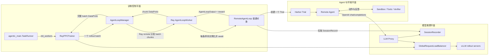
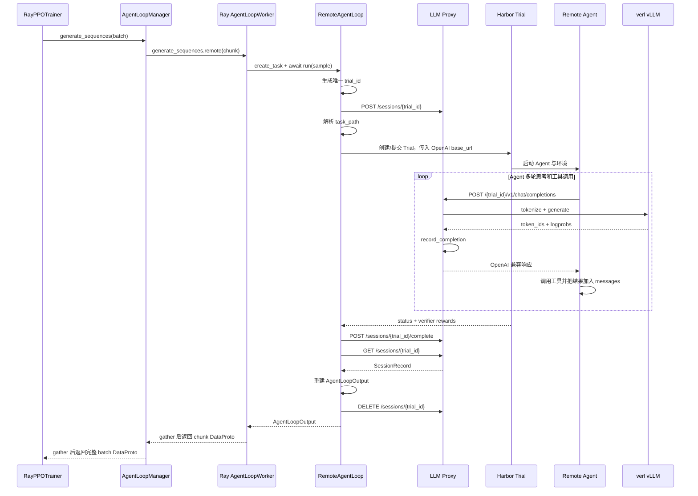

# Agentic Recipe

基于 verl PPO 训练流程的扩展 recipe，引入一个 **OpenAI 兼容的 LLM 代理服务**（proxy server），将远程第三方 Agent 的推理请求桥接到 verl 的 vLLM rollout 服务，从而支持 *agentic* 风格的 RL 训练。

## 1. 适用场景

当 rollout 不再是单轮 prompt → response，而是需要由一个**外部 Agent**（例如 SWE-Agent、ReAct/Tool-Use Agent 等）驱动多轮交互、调用工具、消费环境反馈时，使用本 recipe：

- 训练侧（verl）继续使用标准 PPO/GRPO 训练循环；
- 推理侧通过 HTTP 暴露 OpenAI 兼容接口，给远程 Agent（运行在 [Harbor](../../harbor) 或本地 Trial 中）调用；
- 代理服务负责会话路由、消息记录、tool 解析、tokenization，回收完整 trajectory 给 verl 用于训练。

## 2. 目录结构

```
recipe/agentic/
├── agentic_main.py           # 入口：继承 PPO TaskRunner，init_workers 后启动 proxy server
├── agentic-qwen2.5-3b.sh     # 端到端启动脚本（Qwen2.5 + SWE-Agent 示例）
├── mcp-tools.sh              # MCP 工具相关的辅助脚本
├── swe-agent.yaml            # agent_loop 配置示例（指向 RemoteAgentLoop）
├── config/
│   └── agentic_trainer.yaml  # Hydra 配置：继承 ppo_trainer + proxy_server 配置
├── agent_loop/
│   ├── remote_agent_loop.py  # RemoteAgentLoop：通过 Harbor/本地 Trial 驱动远程 Agent
│   └── config.py             # RemoteAgentConfig：所有参数从环境变量读取
├── proxyserver/              # 代理服务实现
│   ├── ray_actor.py          # ProxyServerActor（Ray named actor，head 节点）
│   ├── proxy_server.py       # FastAPI/uvicorn 入口
│   ├── server.py             # OpenAI 兼容 HTTP endpoints
│   ├── relay.py              # 请求中继 / token 化 / tool 解析
│   ├── recorder.py           # session 记录与 trajectory 回放
│   ├── vllm_provider.py      # 桥接 verl AsyncLLMServerManager
│   ├── worker_client.py      # 独立部署模式下的 WebSocket 推理 worker 客户端
│   ├── models.py             # SessionRecord 等数据模型
│   ├── Dockerfile / deploy.yaml  # 独立部署所需镜像与 K8s 资源
└── serversdk/                # 远程 Agent 调用 verl/proxy 的客户端 SDK
    ├── client.py             # AgentRunClient
    └── models.py
```

## 3. 运行模式

`RemoteAgentLoop` 与代理服务支持两种部署模式（详见 [`agent_loop/remote_agent_loop.py`](recipe/agentic/agent_loop/remote_agent_loop.py)）：

| 模式 | 启用方式 | 说明 |
| --- | --- | --- |
| **Ray actor 模式**（默认） | 不设置 `PROXY_SERVER_URL` | proxy 由 `agentic_main.py` 在 `init_workers()` 后通过 `start_proxy_server()` 创建为 Ray named actor，运行在 head 节点。 |
| **独立 proxy 模式** | 设置 `PROXY_SERVER_URL=http://proxy:port` | proxy 作为独立服务（可用 [`proxyserver/Dockerfile`](recipe/agentic/proxyserver/Dockerfile) + [`proxyserver/deploy.yaml`](recipe/agentic/proxyserver/deploy.yaml) 部署）；agent loop 自动启动 `InferenceWorkerClient` 通过 WebSocket 把 verl 的 vLLM 服务接入 proxy。 |

远程 Agent 收到的 `base_url` 形如：

```
http://${LLM_PROXY_IP}:${port}/${trial_id}/v1
```

其中 `LLM_PROXY_IP` 必须是 Ray 集群外部（例如 Harbor 服务）能访问的 LLM proxy 对外 IP。当 LLM proxy 与 trainer 同机部署时，它就是 trainer 节点本机的对外 IP；独立 proxy 部署时则填独立 proxy 服务的对外 IP。

## 4. 配置优先级与关键参数

`RemoteAgentLoop` / proxy 的参数同时支持三种来源，优先级从高到低：

1. **命令行 override**（`remote_agent.xxx=...`、`proxy_server.llm_proxy_ip=...`）；Hydra 直接写入配置。
2. **shell 环境变量**（`REMOTE_AGENT_NAME` 等）；[`agentic_main.py`](recipe/agentic/agentic_main.py) 中使用 `os.environ.setdefault` 仅在未设时才从 yaml 注入。
3. **yaml 默认值**（[`config/agentic_trainer.yaml`](recipe/agentic/config/agentic_trainer.yaml) 中的 `remote_agent` / `proxy_server.llm_proxy_ip`）；在 driver 启动时被转换成环境变量并通过 Ray `runtime_env.env_vars` 传递给所有 worker。

yaml 字段与环境变量的对应关系：

| yaml 字段 | 环境变量 | 说明 |
| --- | --- | --- |
| `proxy_server.llm_proxy_ip` | `LLM_PROXY_IP` | LLM proxy 对远程 Agent 可达的 IP（proxy 与 trainer 同机时即 trainer 本机 IP） |
| `remote_agent.agent_name` | `REMOTE_AGENT_NAME` | Harbor 上注册的 agent 名 |
| `remote_agent.agent_import_path` | `REMOTE_AGENT_IMPORT_PATH` | 本地 Trial 模式下 agent 的 import path |
| `remote_agent.model_name` | `REMOTE_MODEL_NAME` | 透传给远程 agent 的 model name |
| `remote_agent.agent_kwargs` | `REMOTE_AGENT_KWARGS` | dict，yaml 中直接用嵌套对象 |
| `remote_agent.max_retries` / `retry_base_delay` | `REMOTE_AGENT_MAX_RETRIES` / `REMOTE_AGENT_RETRY_BASE_DELAY` | 重试控制 |
| `remote_agent.task_path_template` | `REMOTE_AGENT_TASK_PATH_TEMPLATE` | 任务路径模板 |
| `remote_agent.environment_overrides` | `REMOTE_AGENT_ENVIRONMENT_OVERRIDES` | dict |
| `remote_agent.environment_kwargs` | `REMOTE_AGENT_ENVIRONMENT_KWARGS` | dict，传给环境构造器 |
| `remote_agent.use_local_trial` | `REMOTE_AGENT_USE_LOCAL_TRIAL` | true 表示本地 Trial 模式 |
| `remote_agent.proxy_server_url` | `PROXY_SERVER_URL` | 设置后走独立 proxy 模式 |
| `remote_agent.harbor_server_url` / `harbor_timeout` | `HARBOR_SERVER_URL` / `HARBOR_TIMEOUT` | Harbor 服务连接 |

> 调试场景可随时用 `export REMOTE_AGENT_USE_LOCAL_TRIAL=true` 临时覆盖 yaml，
> 不需修改配置文件。`PYTHONPATH` 因为需要在 Python 启动前生效，仍保留在 shell 脚本中。

## 5. 快速开始

### 5.1 准备依赖

```bash
# 在 verl 仓库根目录下
uv venv --python 3.12
source .venv/bin/activate
uv pip install -e .
# Harbor 端依赖
uv pip install -e ./harbor
```

### 5.2 安装容器工具（Docker 或 crane + BuildKit）

本地 Trial 模式下 Harbor 环境需要构建/拉取容器镜像。可选择安装 Docker，或使用轻量的 crane + BuildKit 组合：

**方式一：Docker**

按照 [Docker 官方文档](https://docs.docker.com/engine/install/) 安装即可。

**方式二：crane + BuildKit（无需 Docker daemon）**

```bash
# 安装 crane（容器镜像操作工具）
VERSION=v0.20.2
curl -L "https://github.com/google/go-containerregistry/releases/download/${VERSION}/go-containerregistry_Linux_x86_64.tar.gz" -o crane.tar.gz
tar -xzf crane.tar.gz
mv crane /usr/local/bin/

# 安装 buildctl（BuildKit 客户端）
BUILDKIT_VERSION=v0.13.2
curl -sL "https://github.com/moby/buildkit/releases/download/${BUILDKIT_VERSION}/buildkit-${BUILDKIT_VERSION}.linux-amd64.tar.gz" \
  | tar -xz -C /usr/local bin/buildctl
```

### 5.3 下载数据集

使用 Harbor CLI 将任务数据集下载到本地：

```bash
harbor datasets download --output /home/verl/swe-bench-verified
```

下载后的目录结构应符合 [6.1 目录约定](#61-目录约定)。

### 5.4 登录容器镜像仓库

Harbor 环境需要拉取基础镜像，确保已登录目标 registry：

```bash
# 方式一：通过 docker login
docker login <registry-url>

# 方式二：通过 crane login
crane auth login <registry-url> -u <username> -p <password>

# 方式三：直接编辑 ~/.docker/config.json
cat > ~/.docker/config.json <<'EOF'
{
  "auths": {
    "<registry-url>": {
      "auth": "<base64(username:password)>"
    }
  }
}
EOF
```

> **提示**：crane 和 BuildKit 均会读取 `~/.docker/config.json` 中的认证信息，因此三种方式任选其一即可。

### 5.5 启动训练（SWE-Agent + Qwen2.5 示例）

脚本 [`agentic-qwen2.5-3b.sh`](recipe/agentic/agentic-qwen2.5-3b.sh) 通过 `ENVIRONMENT` 环境变量选择运行环境，支持 **Docker**（本地）和 **ACK**（Kubernetes）两种模式。脚本会自动设置对应的 `environment_import_path` 和 `environment_kwargs`。

#### 通用参数

| 变量 | 必填 | 默认值 | 说明 |
| --- | :---: | --- | --- |
| `MODEL_PATH` | **是** | — | HuggingFace 模型本地路径或名称，例如 `/var/model/Qwen2.5-7B-Instruct` |
| `ENVIRONMENT` | 否 | `docker` | 环境模式：`docker`（本地 Docker）或 `ack`（Kubernetes） |
| `REGISTRY` | 否 | *(空)* | 容器镜像 registry 地址，ACK 模式下用于推送/拉取 sandbox 镜像，例如 `my-registry.example.com/swebench` |

#### ACK (Kubernetes) 环境参数

以下参数仅在 `ENVIRONMENT=ack` 时生效，对应 `ACKEnvironment.__init__` 的参数：

| 变量 | 默认值 | 说明 |
| --- | --- | --- |
| `NAMESPACE` | `default` | Kubernetes namespace |
| `KUBECONFIG` | *(空，使用默认 ~/.kube/config)* | kubeconfig 文件路径 |
| `IMAGE_PULL_SECRET` | *(空)* | K8s image pull secret 名称，用于从私有 registry 拉取镜像 |
| `SERVICE_ACCOUNT` | *(空)* | K8s service account 名称 |
| `USE_BUILDKIT` | `false` | 是否使用 BuildKit 构建 sandbox 镜像（替代 DinD）。设为 `true` 时需同时设置 `BUILDKIT_ADDRESS` |
| `BUILDKIT_ADDRESS` | *(空)* | BuildKit 服务地址，例如 `tcp://buildkit-service:1234`。仅当 `USE_BUILDKIT=true` 时生效 |
| `USE_SANDBOX_CLAIM` | `false` | 是否使用 [OpenKruise](https://openkruise.io/) SandboxClaim 获取预热的 sandbox 容器，避免每次冷启动，显著加速环境初始化 |
| `CLAIM_TIMEOUT` | `300` | SandboxClaim 等待超时（秒）。仅当 `USE_SANDBOX_CLAIM=true` 时生效 |
| `SANDBOXSET_REPLICAS` | `5` | SandboxSet 预热副本数。仅当 `USE_SANDBOX_CLAIM=true` 时生效 |

> Docker 模式不需要上述任何 K8s 参数。脚本会自动使用 `DockerEnvironment` 并传入空的 `environment_kwargs`。

#### 完整示例

**Docker 本地环境（最简配置）：**

```bash
MODEL_PATH=/var/model/Qwen2.5-7B-Instruct \
bash recipe/agentic/agentic-qwen2.5-3b.sh
```

**ACK 环境（使用 BuildKit 构建镜像）：**

```bash
MODEL_PATH=/var/model/Qwen2.5-7B-Instruct \
ENVIRONMENT=ack \
REGISTRY=my-registry.example.com/swebench \
KUBECONFIG=/root/.kube/config \
USE_BUILDKIT=true \
BUILDKIT_ADDRESS=tcp://buildkit-service:1234 \
IMAGE_PULL_SECRET=acr-registry \
bash recipe/agentic/agentic-qwen2.5-3b.sh
```

**ACK 环境（使用 OpenKruise SandboxClaim 预热容器）：**

```bash
MODEL_PATH=/var/model/Qwen2.5-7B-Instruct \
ENVIRONMENT=ack \
REGISTRY=my-registry.example.com/swebench \
KUBECONFIG=/root/.kube/config \
USE_SANDBOX_CLAIM=true \
SANDBOXSET_REPLICAS=10 \
IMAGE_PULL_SECRET=acr-registry \
bash recipe/agentic/agentic-qwen2.5-3b.sh
```

#### 要点

- `actor_rollout_ref.rollout.mode=async`：rollout 必须使用异步模式；
- `actor_rollout_ref.rollout.agent.default_agent_loop=remote_agent`：使用本 recipe 提供的 `RemoteAgentLoop`；
- `agent_loop_config_path`：指向 [`swe-agent.yaml`](recipe/agentic/swe-agent.yaml)（也可以替换为自定义 yaml）。

### 5.6 自定义 proxy 监听端口

修改 [`config/agentic_trainer.yaml`](recipe/agentic/config/agentic_trainer.yaml) 或在命令行 override：

```yaml
proxy_server:
  host: "0.0.0.0"
  port: 0           # 0 表示随机端口
  tool_format: "hermes"
```

```bash
python3 -m recipe.agentic.agentic_main \
    proxy_server.port=9123 \
    proxy_server.tool_format=hermes \
    ...
```

## 6. 从 Harbor 本地任务目录构建数据集

除了手工准备好的 parquet，agentic recipe 还支持直接从两个 **本地 Harbor 任务目录**（分别对应 train / val）构建数据集，适用于已经将 Harbor 任务同步到本地磁盘的场景。

### 6.1 目录约定

输入目录下的每个子目录被视为一个 Harbor task，**必须**包含如下两个文件：

```
<train_root>/
    task-001/
        task.toml          # TOML 格式任务配置（会被写入 extra_info.task_metadata）
        instruction.md     # 作为 user prompt 内容
        environment/       # 可选，不被读取
        tests/             # 可选，不被读取
    task-002/
        ...
<val_root>/
    ...
```

不同时包含 `task.toml` 与 `instruction.md` 的子目录会被跳过。

### 6.2 生成的 row schema

与 verl 默认 RL row 一致：

```python
{
    "data_source": "harbor",
    "prompt": [{"role": "user", "content": <instruction.md 内容>}],
    "ability": "agent",
    "reward_model": {"style": "rule", "ground_truth": <task_id>},
    "extra_info": {
        "split": "train" | "val",
        "index": <从 0 起的序号>,
        "task_id": <子目录名>,
        "local_path": <任务本地路径>,
        "task_metadata": <task.toml 中的 metadata 表>,
    },
    "instance_id": <子目录名>,         # 顶层字段，会原样透传给 RemoteAgentLoop.run 的 kwargs
    "local_task_path": <任务本地路径>,  # 顶层字段，含任务目录绝对路径
}
```

实现参见 [`dataset/local_harbor.py`](recipe/agentic/dataset/local_harbor.py)，本地扫描不依赖 OSS / `oss2` SDK。

### 6.3 配置项

在 [`config/agentic_trainer.yaml`](recipe/agentic/config/agentic_trainer.yaml) 中的 `data` 节点下：

| 字段 | 说明 |
| --- | --- |
| `data.train_harbor_dir` | 训练集任务根目录（含多个子任务目录）。为 `null` 时不启用，使用原 `data.train_files` |
| `data.val_harbor_dir` | 验证集任务根目录。为 `null` 时不启用，使用原 `data.val_files` |
| `data.harbor_cache_dir` | 生成的 parquet 缓存路径，默认 `~/.cache/verl/agentic/harbor` |
| `data.harbor_data_source` | row 中 `data_source` 字段值，默认 `harbor` |
| `data.harbor_ability` | row 中 `ability` 字段值，默认 `agent` |
| `data.harbor_overwrite` | `true` 时强制重新生成 parquet（默认复用缓存） |
| `data.harbor_train_limit` / `data.harbor_val_limit` | 可选上限，仅取前 N 个任务用于快速调试 |

启动后 [agentic_main.py](recipe/agentic/agentic_main.py) 会在加载 dataset 之前调用 `_materialize_harbor_datasets`：

1. 扫描 `train_harbor_dir` / `val_harbor_dir`，调用 `build_verl_parquets` 生成 `train-<sig>.parquet` / `val-<sig>.parquet`（文件名中 `<sig>` 是输入参数的哈希，同样输入仅生成一次）；
2. 通过 `OmegaConf.update` 覆盖 `data.train_files` 与 `data.val_files`；
3. 后续逻辑走 verl 原生的 `create_rl_dataset(parquet_paths, ...)`，无需任何定制 Dataset。

### 6.4 示例

```bash
PYTHONPATH=/home/verl/harbor/src/harbor:$PYTHONPATH \
python3 -m recipe.agentic.agentic_main \
    data.train_harbor_dir=/var/harbor/tasks/train \
    data.val_harbor_dir=/var/harbor/tasks/val \
    data.harbor_cache_dir=/var/cache/verl/agentic/harbor \
    proxy_server.llm_proxy_ip=10.0.30.11 \
    remote_agent.agent_name=swe-agent \
    remote_agent.use_local_trial=true \
    ... # 其它 PPO/GRPO 配置项
```

你不必再传 `data.train_files` / `data.val_files` —— 这两项会在 driver 启动时被生成的 parquet 路径覆盖。若同时传了 parquet 与 Harbor 目录，后者会赢。

### 6.5 RemoteAgentLoop 自动解析 task_path

[`RemoteAgentLoop`](recipe/agentic/agent_loop/remote_agent_loop.py) 中的 `_resolve_task_path()` 会按以下顺序解析单条 rollout 的 `task_path`：

1. **`local_task_path`**：dataset row 顶层字段（由本地 Harbor builder 写入），若指向存在的目录直接采用，无需再拼接路径；
2. **`<harbor_root>/<instance_id>`**：依次在 `data.train_harbor_dir`、`data.val_harbor_dir`、以及 env `HARBOR_DATASET_DIRS`（`:` 或 `,` 分隔）下查找；
3. **`task_path_template.format(instance_id=...)`**：兜底，保留旧的 `REMOTE_AGENT_TASK_PATH_TEMPLATE` 工作流。

意味着只要数据集是用本地 Harbor builder 生成的，启动时无须再设置 `remote_agent.task_path_template`，agent loop 会用 `instance_id` 自动定位任务目录。在独立 proxy 模式下若 worker 看不到 trainer config，也可改用 env：

```bash
export HARBOR_DATASET_DIRS=/var/harbor/tasks/train:/var/harbor/tasks/val
```

## 7. 工作流程

```
                 ┌─────────────────────┐
                 │  RayPPOTrainer      │  init_workers() → LLMServerManager + LB
                 └─────────┬───────────┘
                           │ start_proxy_server(load_balancer, ...)
                           ▼
       ┌────────────────────────────────────────┐
       │  ProxyServerActor (Ray named actor)    │  HTTP/WebSocket
       │  - OpenAI 兼容 endpoints               │◄────────────────┐
       │  - session 路由 / 记录 trajectory       │                 │
       └─────────┬──────────────────────────────┘                 │
                 │ AsyncLLM (vLLM)                                │
                 ▼                                                │
       verl rollout workers (vLLM TP)                             │
                                                                  │
                                                                  │ OpenAI base_url
                                                                  │
                                                       ┌──────────┴────────────┐
                                                       │ Remote Agent (Harbor) │
                                                       │ e.g. SWE-Agent, ReAct │
                                                       └───────────────────────┘
```

1. `agentic_main.TaskRunner.run()` 启动标准 PPO 流程；
2. 在 `trainer.init_workers()` 之后、`trainer.fit()` 之前调用 `start_proxy_server`，把 `trainer.llm_server_manager.global_load_balancer` 这个 LB actor handle 注入 proxy；
3. 每个 rollout 步骤里 `RemoteAgentLoop` 向 proxy 注册 session、把 `base_url` 交给远程 Agent；
4. 远程 Agent 通过 OpenAI 协议调用 proxy，proxy 再把请求转发给 verl 的 vLLM 服务；
5. 会话结束后 `RemoteAgentLoop` 从 proxy 拉取完整 token 序列、tool 调用记录，构造 `AgentLoopOutput` 返回训练器。

## 8. 将 Agentic 能力集成到你自己的算法

Agentic recipe 在标准 PPO 训练之上增加了两个组件：

1. **Proxy Server** — 桥接远程 Agent 的 OpenAI 兼容 HTTP 请求到 verl 的 vLLM rollout 服务，同时记录每次 LLM 调用的 token IDs 和 logprobs。
2. **Remote Agent Loop**（`RemoteAgentLoop`）— 每条样本的 rollout 编排：将任务分发给远程 Agent 框架（如 Harbor），并从 proxy 的录制数据重建 verl 兼容的 trajectory。

```
┌─────────────────────────────────────────────────────┐
│  Your TaskRunner                                    │
│                                                     │
│  1. init_workers()   ← 标准 verl 初始化              │
│  2. start_proxy()    ← agentic: 桥接 LLM 流量        │
│  3. fit()            ← 标准 verl 训练                 │
└─────────────────────────────────────────────────────┘

Per-sample rollout:
┌──────────────┐     HTTP/OpenAI     ┌──────────────┐
│ Remote Agent │ ◄──────────────────► │ LLM Proxy    │
│ (Harbor,     │                      │ (records      │
│  SWE-agent,  │                      │  token_ids +  │
│  custom)     │                      │  logprobs)    │
└──────────────┘                      └──────┬───────┘
                                             │ routes to
                                      ┌──────▼───────┐
                                      │ verl vLLM    │
                                      │ rollout      │
                                      │ servers      │
                                      └──────────────┘
```

根据你的需求，有三种集成方式：

### 8.1 方式一：直接使用 Agentic Recipe

如果你的算法基于 PPO，只需自定义远程 Agent 或环境，可以直接用现有 recipe + 配置覆盖。

**步骤 1：创建继承 agentic trainer 的 YAML 配置。**

```yaml
# my_config.yaml
hydra:
  searchpath:
    - file://verl/trainer/config

defaults:
  - ppo_trainer
  - _self_

# Proxy server 设置
proxy_server:
  host: "0.0.0.0"
  port: 0
  tool_format: "hermes"
  llm_proxy_ip: <你的外部 IP>

# 远程 Agent 设置
remote_agent:
  agent_name: my_custom_agent
  agent_import_path: "my_package.agents:MyAgent"
  use_local_trial: true
  environment_import_path: "harbor.environments.docker.docker:DockerEnvironment"
```

**步骤 2：运行。**

```bash
python -m recipe.agentic.agentic_main --config-name my_config
```

这会使用内置的 `RemoteAgentLoop`（注册名 `"remote_agent"`）和 agentic `TaskRunner`，自动管理 proxy server 生命周期。

### 8.2 方式二：在你自己的 TaskRunner 中添加 Proxy Server

如果你有自定义的 `TaskRunner`（例如非 PPO 算法），需要自己在 `init_workers()` 和 `fit()` 之间启动 proxy server。

**步骤 1：继承 base TaskRunner 并插入 proxy 启动。**

```python
# my_recipe/main.py
import os
from verl.trainer.main_ppo import TaskRunner as BaseTaskRunner

class MyAgenticTaskRunner(BaseTaskRunner):
    """在自定义 TaskRunner 中添加 LLM proxy server。"""

    def run(self, config):
        from pprint import pprint
        from omegaconf import OmegaConf
        from verl.utils.fs import copy_to_local
        from verl.utils import hf_tokenizer, hf_processor
        from verl.utils.dataset.rl_dataset import collate_fn
        from verl.trainer.main_ppo import create_rl_dataset, create_rl_sampler
        from verl.trainer.ppo.ray_trainer import RayPPOTrainer
        from verl.trainer.ppo.utils import need_critic, need_reference_policy
        from verl.utils.config import validate_config

        pprint(OmegaConf.to_container(config, resolve=True))
        OmegaConf.resolve(config)

        # --- 标准 verl 初始化（与 base TaskRunner 相同）---
        actor_rollout_cls, ray_worker_group_cls = self.add_actor_rollout_worker(config)
        self.add_critic_worker(config)
        self.add_reward_model_resource_pool(config)
        self.add_teacher_model_resource_pool(config)
        self.add_ref_policy_worker(config, actor_rollout_cls)

        validate_config(
            config=config,
            use_reference_policy=need_reference_policy(config),
            use_critic=need_critic(config),
        )

        local_path = copy_to_local(
            config.actor_rollout_ref.model.path,
            use_shm=config.actor_rollout_ref.model.get("use_shm", False),
        )
        trust_remote_code = config.data.get("trust_remote_code", False)
        tokenizer = hf_tokenizer(local_path, trust_remote_code=trust_remote_code)
        processor = hf_processor(local_path, trust_remote_code=trust_remote_code, use_fast=True)
        resource_pool_manager = self.init_resource_pool_mgr(config)

        train_dataset = create_rl_dataset(
            config.data.train_files, config.data, tokenizer, processor,
            is_train=True, max_samples=config.data.get("train_max_samples", -1),
        )
        val_dataset = create_rl_dataset(
            config.data.val_files, config.data, tokenizer, processor,
            is_train=False, max_samples=config.data.get("val_max_samples", -1),
        )
        train_sampler = create_rl_sampler(config.data, train_dataset)

        trainer = RayPPOTrainer(
            config=config,
            tokenizer=tokenizer,
            processor=processor,
            role_worker_mapping=self.role_worker_mapping,
            resource_pool_manager=resource_pool_manager,
            ray_worker_group_cls=ray_worker_group_cls,
            train_dataset=train_dataset,
            val_dataset=val_dataset,
            collate_fn=collate_fn,
            train_sampler=train_sampler,
        )
        trainer.init_workers()

        # --- Agentic: 启动 LLM proxy server ---
        self._start_proxy(trainer, config)

        # --- 你的自定义逻辑（如有）---

        trainer.fit()

    def _start_proxy(self, trainer, config):
        """在 workers 初始化之后启动 LLM proxy server。"""
        load_balancer = trainer.llm_server_manager.global_load_balancer
        proxy_cfg = config.get("proxy_server", {})
        standalone_proxy_url = os.environ.get("PROXY_SERVER_URL")

        if standalone_proxy_url:
            # 外部 proxy 模式：仅注册 load balancer
            from recipe.agentic.proxyserver.ray_actor import start_lb_registry
            start_lb_registry(load_balancer=load_balancer)
            print(f"[agentic] standalone proxy: {standalone_proxy_url}")
        else:
            # 本地 proxy 模式：启动完整 HTTP proxy（Ray actor）
            from recipe.agentic.proxyserver.ray_actor import start_proxy_server
            proxy_url = start_proxy_server(
                load_balancer=load_balancer,
                model_path=config.actor_rollout_ref.model.path,
                host=proxy_cfg.get("host", "0.0.0.0"),
                port=proxy_cfg.get("port", 0),
                tool_format=proxy_cfg.get("tool_format", "hermes"),
            )
            print(f"[agentic] proxy server started at {proxy_url}")
```

**步骤 2：在你的 YAML 配置中添加 proxy_server 和 remote_agent 配置。**

```yaml
# 追加到你现有的配置中
proxy_server:
  host: "0.0.0.0"
  port: 0
  tool_format: "hermes"
  llm_proxy_ip: <你的外部 IP>

remote_agent:
  agent_import_path: "my_package.agents:MyAgent"
  use_local_trial: true
```

**步骤 3：设置 agent loop 使用 `remote_agent`。**

`RemoteAgentLoop` 在 verl 的 agent loop registry 中注册名为 `"remote_agent"`，在 rollout 配置中指定：

```yaml
actor_rollout_ref:
  rollout:
    agent:
      default_agent_loop: remote_agent
      agent_loop_config_path: null
```

## 9. 相关参考

- 入口实现：[`agentic_main.py`](recipe/agentic/agentic_main.py)
- 远程 agent loop：[`agent_loop/remote_agent_loop.py`](recipe/agentic/agent_loop/remote_agent_loop.py)
- Proxy actor 启动：[`proxyserver/ray_actor.py`](recipe/agentic/proxyserver/ray_actor.py)
- Harbor 端 Agent 实现：[`../../harbor`](../../harbor)
- 基础 PPO 训练入口：[`verl/trainer/main_ppo.py`](../../verl/trainer/main_ppo.py)

---

# Agentic Recipe 架构与执行流程学习指南

> 原基于分支 `feat/add-agentic-training-example` 编写，已于 2026-10 与 verl 主线对齐（修复记录见附录 A.7）。
>
> 建议先通读第 1～4 章建立主链路，再沿第 9 章的顺序阅读源码。

当前下载的是 recipe 仓库，不包含它所依赖的完整 `verl` 与 `harbor` 源码。代码中的 `verl.*`、`harbor.*` 需要由对应项目提供；运行示例还假定本仓库位于完整 verl 工程的 `recipe/` 路径下。因此本文聚焦当前 `agentic` 目录能够验证的集成逻辑，对 verl 内部 PPO 循环和 Harbor 内部 Agent 实现只说明接口边界。

## 1. 先建立一个正确的心智模型

传统 rollout 通常是：

```text
prompt -> 模型一次生成 response -> 计算 reward -> 更新模型
```

本项目的 agentic rollout 是：

```text
任务 -> 外部 Agent 规划和调用工具
     -> Agent 多次请求正在训练的模型
     -> 环境返回工具执行结果
     -> Agent 继续请求模型
     -> 任务结束并验证
     -> 把多轮模型输出重新拼成一条可训练 trajectory
```

最关键的分工是：

- **verl / vLLM**：提供“正在训练的模型”的推理能力。
- **Remote Agent**：决定何时问模型、调用什么工具、如何根据环境反馈继续行动。
- **Proxy Server**：把 Agent 的 OpenAI 请求转给 verl vLLM，同时记录训练所需的 token IDs 和 logprobs。
- **RemoteAgentLoop**：管理一条样本的完整生命周期，并把 Proxy 记录重建成 `AgentLoopOutput`。
- **RayPPOTrainer**：消费 `AgentLoopOutput`、reward 等数据，继续执行标准 PPO/GRPO 训练。

一句话概括：

> Agent 负责“怎么做任务”，vLLM 负责“生成下一步”，Proxy 负责“转发并留痕”，RemoteAgentLoop 负责“把整个任务变回 verl 能训练的数据”。

## 2. 如何看懂 README 的架构图

README 中的图可以展开成三个平面。



### 2.1 图中最容易误解的三条线

1. `RemoteAgentLoop -> Harbor/Agent` 是**任务编排链路**，不是模型推理链路。
2. `Agent -> Proxy -> vLLM` 才是**模型推理链路**；Agent 不应绕过 Proxy 直接请求其他模型。
3. `Proxy recorder -> RemoteAgentLoop -> Trainer` 是**训练数据回收链路**；只返回文本不够，训练还需要准确的 token IDs、logprobs 和 mask。

### 2.2 五个核心名词

| 名词 | 在本项目中的含义 |
| --- | --- |
| sample | Dataset 中的一行任务，例如一个 SWE-bench 实例 |
| rollout | 针对一行任务执行一次 Agent 尝试 |
| trial | Harbor 对这次任务执行的封装，包含 Agent、环境和 verifier |
| session | Proxy 用 `trial_id` 隔离并记录的一次 rollout 的全部 LLM 请求 |
| turn | session 中的一次 chat completion，即 Agent 对模型的一次调用 |

通常是一条 sample 对应一个 rollout、一个 Harbor trial 和一个 Proxy session；一个 session 内可以有多个 turn。

### 2.3 `GlobalRequestLoadBalancer` 不是 vLLM 地址

> **核心结论：`load_balancer` 是管理多个 vLLM rollout server 的 Ray actor handle，不是某个 server 的 URL。**

Proxy 调用它的过程是：

```text
GlobalRequestLoadBalancer.acquire_server(trial_id)
  -> 返回 (server_id, vLLM server actor handle)
  -> server.generate.remote(...)
  -> GlobalRequestLoadBalancer.release_server(server_id)
```

它负责 server 选择、负载统计和 sticky routing。同一个 `trial_id` 尽量路由到同一 vLLM replica，从而复用 prefix cache。需要区分：

| 对象 | 含义 |
| --- | --- |
| `proxy_url` | Agent 可以访问的 HTTP 地址 |
| `load_balancer` | 管理和调度多个 vLLM server 的 Ray actor handle |
| `server` | 被选中的 vLLM server actor handle |
| `server_id` | 该 vLLM server 的内部标识 |

## 3. 模块职责地图

| 文件 | 首先关注的符号 | 职责 |
| --- | --- | --- |
| [`agentic_main.py`](recipe/agentic/agentic_main.py) | `main`、`run_ppo`、`TaskRunner.run` | 加载配置、初始化 Ray/Trainer、在 `init_workers` 与 `fit` 之间启动 Proxy |
| [`config/agentic_trainer.yaml`](recipe/agentic/config/agentic_trainer.yaml) | `data`、`proxy_server`、`remote_agent` | 在标准 `ppo_trainer` 上增加 agentic 配置 |
| [`remote-agent.yaml`](recipe/agentic/remote-agent.yaml) | `_target_` | 告诉 verl 如何加载 `RemoteAgentLoop` |
| [`agent_loop/remote_agent_loop.py`](recipe/agentic/agent_loop/remote_agent_loop.py) | `RemoteAgentLoop.run` | 一条样本的 session、Trial、reward 和 trajectory 编排 |
| [`agent_loop/config.py`](recipe/agentic/agent_loop/config.py) | `RemoteAgentConfig.from_env` | 在 worker 中从环境变量恢复 Agent 配置 |
| [`proxyserver/server.py`](recipe/agentic/proxyserver/server.py) | `LLMProxyServer`、`_build_app` | 框架无关的 FastAPI、session REST API、OpenAI API、WebSocket API |
| [`proxyserver/ray_actor.py`](recipe/agentic/proxyserver/ray_actor.py) | `start_proxy_server`、`_get_actor_class`、`PROXY_ACTOR_NAME` | 把 Proxy 接入 Ray 和 verl 的 load balancer（actor 类由工厂动态生成） |
| [`proxyserver/vllm_provider.py`](recipe/agentic/proxyserver/vllm_provider.py) | `VLLMRayProvider._generate` | tokenize、选择 vLLM server、生成、解析 tool call |
| [`proxyserver/recorder.py`](recipe/agentic/proxyserver/recorder.py) | `SessionRecorder` | 按 session 保存每轮请求和模型结果 |
| [`proxyserver/relay.py`](recipe/agentic/proxyserver/relay.py) | `InferenceRelay.dispatch` | 独立 Proxy 模式下通过 WebSocket 分发推理请求 |
| [`proxyserver/worker_client.py`](recipe/agentic/proxyserver/worker_client.py) | `InferenceWorkerClient` | 从 verl 一侧连接独立 Proxy，并调用 vLLM |
| [`dataset/local_harbor.py`](recipe/agentic/dataset/local_harbor.py) | `task_to_verl_row` | 把 Harbor 本地任务目录转换成 verl parquet |
| [`serversdk/client.py`](recipe/agentic/serversdk/client.py) | `AgentRunClient.submit_async` | 打包任务目录并提交到远程 Harbor 服务 |

## 4. 总执行流程：从启动命令到开始训练

### 4.1 启动脚本选择 Agent Loop

[`agentic-qwen2.5-3b.sh`](recipe/agentic/agentic-qwen2.5-3b.sh) 最重要的不是超参数，而是这几项：

```text
actor_rollout_ref.rollout.mode=async
actor_rollout_ref.rollout.agent.default_agent_loop=remote_agent
actor_rollout_ref.rollout.agent.agent_loop_config_path=recipe/agentic/remote-agent.yaml
```

含义分别是：

1. rollout 使用 async 模式；
2. 默认 agent loop 名为 `remote_agent`；
3. 从 `remote-agent.yaml` 加载 `RemoteAgentLoop`。

`RemoteAgentLoop` 类上还有 `@register("remote_agent")`，因此配置名、registry 名和类实现完成对应。

### 4.2 Hydra 入口

调用链从 [`agentic_main.py`](recipe/agentic/agentic_main.py) 开始：

```text
main(config)
  -> auto_set_device(config)
  -> migrate_legacy_reward_impl(config)
  -> run_ppo(config)
```

Hydra 先加载 [`config/agentic_trainer.yaml`](recipe/agentic/config/agentic_trainer.yaml)。该配置通过 `defaults: [ppo_trainer, _self_]` 继承 verl 标准 PPO 配置，再覆盖 agentic 所需字段。

### 4.3 Ray 初始化与环境变量传播

`run_ppo` 调用 `collect_yaml_env_overrides(config)`，把 `remote_agent.*` 和 `proxy_server.llm_proxy_ip` 转成环境变量：

```text
remote_agent.agent_name       -> REMOTE_AGENT_NAME
remote_agent.agent_kwargs     -> REMOTE_AGENT_KWARGS（JSON）
remote_agent.use_local_trial  -> REMOTE_AGENT_USE_LOCAL_TRIAL
proxy_server.llm_proxy_ip     -> LLM_PROXY_IP
...
```

这些变量同时写入：

- 当前 driver 的 `os.environ`；
- `ray.init(runtime_env.env_vars=...)`，供 Ray worker 继承。

这样 `RemoteAgentLoop` 即使运行在其他 Ray worker 中，也能通过 `RemoteAgentConfig.from_env()` 得到配置。

### 4.4 `TaskRunner.run` 复用标准 PPO 初始化

主干调用顺序是：

```text
add_actor_rollout_worker
add_critic_worker
add_reward_model_resource_pool
add_teacher_model_resource_pool
add_ref_policy_worker
validate_config
copy_to_local(model)
构造 tokenizer / processor
init_resource_pool_mgr
构造 dataset / sampler
构造 RayPPOTrainer
trainer.init_workers()
启动 Agentic Proxy
trainer.fit()
```

Agentic recipe 真正插入标准 PPO 的关键位置只有一个：

```python
trainer.init_workers()
# 此后 trainer 已持有 async_rollout_manager（AgentLoopManager 实例，
# 其 _init_global_load_balancer() 在 init_workers 内创建 global_load_balancer）
start_proxy_server(...)
trainer.fit()
```

Proxy 必须在 `init_workers()` 之后启动，因为它依赖：

```text
trainer.async_rollout_manager.global_load_balancer
```

它又必须在 `fit()` 之前启动，因为第一批 rollout 开始时，外部 Agent 就会请求 Proxy。

### 4.5 数据集物化：Harbor 任务如何桥接到 verl rollout

> **先记住核心结论：这里不是把 Harbor 任务完整转换成 parquet，再从 parquet 还原成 Harbor。parquet 只保存 verl 调度需要的“一行样本”和原任务目录的定位信息；执行 Trial 时，`RemoteAgentLoop` 会沿 `local_task_path` 回到磁盘上的原始 Harbor 目录。**

完整链路如下：

```text
原始 Harbor 任务目录
  -> local_harbor.py 扫描并建立索引
  -> verl-compatible parquet（一行对应一个任务）
  -> RLHFDataset / DataLoader
  -> DataProto.non_tensor_batch
  -> AgentLoopWorker 逐样本拆出 kwargs
  -> RemoteAgentLoop.run(..., instance_id, local_task_path, ...)
  -> _resolve_task_path() 找回原始 Harbor 目录
  -> TrialConfig(TaskConfig(path=task_path))
  -> Harbor 从原始目录启动 Agent、环境和 verifier
```

#### 4.5.1 Harbor 原始数据是什么

Harbor 眼中的一个 sample 不是单条 JSON，而是一个**可执行任务目录**。本 recipe 判断一个子目录是否为任务的最低条件是同时存在：

```text
/home/verl/swe-bench-verified/
├── task-001/
│   ├── task.toml          # Harbor 任务配置
│   ├── instruction.md     # 给 Agent 的任务说明
│   ├── environment/       # 可选：环境构建材料
│   ├── tests/             # 可选：验证测试
│   └── solution/          # 可选：其他 Harbor 任务材料
└── task-002/
    ├── task.toml
    └── instruction.md
```

其中：

- `instruction.md` 是自然语言任务，例如“修复某个仓库中的某个 bug”；
- `task.toml` 的完整 schema 由 Harbor 定义，本 builder 只额外读取其中可选的 `[metadata]` 表；
- `environment/`、`tests/` 等不会被 builder 写入 parquet，但 Harbor 真正执行 Trial 时仍可能需要它们；
- 因此**原始任务目录不能在生成 parquet 后删除**：本地 Trial 要求执行 worker 能看到该目录；远程 Trial 至少要求提交端能看到它，以便先打成 `tar.gz` 再上传。

#### 4.5.2 verl 对一行 RL 数据的要求

verl 的标准 RL 数据入口是 parquet/json 中的一行字典。对本 recipe 而言，可把字段分成两组。

第一组是 verl 通用字段：

| 字段 | 本 recipe 写入的值 | 用途 |
| --- | --- | --- |
| `prompt` | `[{'role': 'user', 'content': instruction}]` | 标准 chat prompt；来自 `instruction.md` |
| `data_source` | `"harbor"` | 标识数据来源，供 reward/日志等逻辑使用 |
| `ability` | `"agent"` | 标识任务能力类型 |
| `reward_model` | `{'style': 'rule', 'ground_truth': task_id}` | verl 的 reward 描述；本 recipe 的最终 reward 实际主要来自 Harbor verifier |
| `extra_info` | split、index、task metadata 等 | 辅助信息、索引和日志元数据 |

第二组是 agentic recipe 增加的“回到 Harbor”的桥接字段：

| 字段 | 值 | 用途 |
| --- | --- | --- |
| `instance_id` | 任务子目录名，例如 `task-001` | 稳定任务 ID，也可用于在 Harbor 根目录下重新查找任务 |
| `local_task_path` | 原任务目录绝对路径 | 最直接地定位完整 Harbor 任务目录 |

所以 `task-001` 经过 [`task_to_verl_row`](recipe/agentic/dataset/local_harbor.py) 后，parquet 中逻辑上是这样一行：

```python
{
    "data_source": "harbor",
    "prompt": [
        {
            "role": "user",
            "content": "<instruction.md 的完整文本>",
        }
    ],
    "ability": "agent",
    "reward_model": {
        "style": "rule",
        "ground_truth": "task-001",
    },
    "extra_info": {
        "split": "train",
        "index": 0,
        "task_id": "task-001",
        "local_path": "/home/verl/swe-bench-verified/task-001",
        "task_metadata": {"...": "task.toml 的 metadata 子表"},
    },
    "instance_id": "task-001",
    "local_task_path": "/home/verl/swe-bench-verified/task-001",
}
```

注意：parquet **复制了任务说明和部分 metadata**，但没有复制完整可执行任务目录。`environment/`、`tests/` 等仍只存在于原目录中。另外，`extra_info.local_path` 虽然也保存路径，但 `RemoteAgentLoop.run()` 直接读取的是顶层 `local_task_path`；顶层字段是实际的运行时桥接字段。

#### 4.5.3 “物化”具体做了什么

[`agentic_main._materialize_harbor_datasets`](recipe/agentic/agentic_main.py) 在创建 verl Dataset 之前运行：

```text
iter_local_task_dirs(root)
  -> 只选择同时含 task.toml + instruction.md 的直接子目录
parse_local_task_dir(task_dir)
  -> 读取 instruction.md 和 task.toml
build_rows_from_local(...)
  -> 每个任务调用 task_to_verl_row(...)
Dataset.from_list(rows).to_parquet(...)
  -> 写出 train-<sig>.parquet / val-<sig>.parquet
OmegaConf.update(...)
  -> 用生成路径覆盖 data.train_files / data.val_files
```

`<sig>` 是输入根目录、split、limit 等参数的短哈希。相同输入且 `harbor_overwrite=false` 时复用缓存，避免每次启动都重建 parquet。

之后 recipe 不再使用自定义 Dataset，而是回到 verl 标准路径：

```python
train_dataset = create_rl_dataset(
    config.data.train_files,
    config.data,
    tokenizer,
    processor,
    is_train=True,
)
```

#### 4.5.4 parquet 字段如何进入 `DataProto`

对应版本的 verl `RLHFDataset` 会读取 parquet，并在取单条样本时保留行中的顶层字段。它还会根据 `data.prompt_key` 取出 chat messages，增加运行时字段 `raw_prompt`：

```python
row = dataframe[item]
row["raw_prompt"] = build_messages(row, key=prompt_key)
return row
```

这里几个名称容易混淆：

- `prompt`：parquet 中持久化的标准 chat 字段；
- `prompt_key`：告诉 `RLHFDataset` 应从哪一列取 prompt；
- `raw_prompt`：Dataset `__getitem__` 动态加入的、尚未转成 token IDs 的消息列表；
- `local_task_path`、`instance_id`：普通顶层非 tensor 字段，原样保留。

DataLoader 的 `collate_fn` 把一个 batch 分成：

```text
torch.Tensor 字段
  -> torch.stack
  -> DataProto.batch

字符串、list、dict 等非 tensor 字段
  -> np.ndarray(dtype=object)
  -> DataProto.non_tensor_batch
```

因此 batch 进入 rollout 前大致是：

```python
DataProto(
    batch={
        "dummy_tensor": Tensor[batch_size, ...],
    },
    non_tensor_batch={
        "raw_prompt": np.array([messages_0, messages_1, ...], dtype=object),
        "instance_id": np.array(["task-001", "task-002", ...], dtype=object),
        "local_task_path": np.array(["/abs/task-001", "/abs/task-002", ...], dtype=object),
        "extra_info": np.array([info_0, info_1, ...], dtype=object),
        # 其他 parquet 顶层字段……
    },
)
```

这就是 verl 与自定义 Agent Loop 之间的通用数据协议：tensor 放 `batch`，Python 对象放 `non_tensor_batch`。

#### 4.5.5 verl 如何逐样本透传给 `RemoteAgentLoop`

`AgentLoopManager` 把完整 `DataProto` 切给多个 `AgentLoopWorker`。Worker 在处理第 `i` 条样本时，从每个非 tensor 列取第 `i` 个值：

```python
kwargs = {
    key: values[i]
    for key, values in batch.non_tensor_batch.items()
    if key != "__do_sample__"
}

output = await agent_loop.run(sampling_params, **kwargs)
```

所以某一次 [`RemoteAgentLoop.run`](recipe/agentic/agent_loop/remote_agent_loop.py) 实际收到的形态类似：

```python
await remote_agent_loop.run(
    sampling_params={"temperature": 1.0, "top_p": 1.0, ...},
    raw_prompt=[{"role": "user", "content": "..."}],
    instance_id="task-001",
    local_task_path="/home/verl/swe-bench-verified/task-001",
    extra_info={...},
    data_source="harbor",
    reward_model={...},
    ...,
)
```

这里不是为每个字段手写函数参数，而是统一通过 `**kwargs` 透传；因此自定义 parquet 顶层字段也能到达自定义 Agent Loop。

#### 4.5.6 `RemoteAgentLoop` 如何重新拿到 Harbor 任务

`RemoteAgentLoop` 不会把 `raw_prompt` 或 parquet 重新拼成 `task.toml`、`tests/`、`environment/`。它只解析原任务目录的位置：

```python
instance_id = kwargs.get("instance_id", "")
task_path = self._resolve_task_path(
    instance_id,
    explicit_local_path=kwargs.get("local_task_path"),
)
```

路径解析顺序是：

1. `local_task_path` 指向存在的目录时直接使用；
2. 在 `data.train_harbor_dir/<instance_id>`、`data.val_harbor_dir/<instance_id>` 下查找；
3. 在 `$HARBOR_DATASET_DIRS` 指定的根目录下查找；
4. 最后使用 `task_path_template.format(instance_id=...)`。

拿到 `task_path` 后有两种情况：

```text
本地 Trial
  -> TrialConfig(task=TaskConfig(path=task_path), ...)
  -> Trial.create(...)
  -> Harbor 直接读取该完整目录

远程 Trial
  -> AgentRunClient.submit_async(task_path=task_path, ...)
  -> 把完整目录打成 task.tar.gz
  -> 上传给远程 Harbor
  -> 远程 Harbor 解包后创建 Trial
```

因此真正的桥接关系是：

```text
parquet row.local_task_path
  -> RemoteAgentLoop 的 task_path
  -> Harbor Trial 的 TaskConfig.path
```

而不是：

```text
parquet row
  -X-> 在内存里还原出 Harbor task
```

#### 4.5.7 `prompt` 与 Harbor `instruction.md` 为什么看起来重复

两者服务于不同系统：

- verl 需要 `prompt`/`raw_prompt` 来满足标准 Dataset 和 AgentLoop 数据接口、执行长度过滤并描述这条 rollout 样本；
- Harbor 需要完整任务目录来启动 Agent、sandbox 和 verifier；远程 Agent 真正看到的任务材料由 Harbor Trial 提供；
- 本 recipe 完成 rollout 后，又以 Proxy 记录的第一轮 `request_messages` 作为最终 `AgentLoopOutput.prompt_ids` 的来源，确保训练 prompt 与 Agent 实际发给模型的内容一致。

也就是说，parquet 中的 `prompt` 是 verl 侧的样本表示；Harbor 目录中的 `instruction.md` 是任务执行侧的源文件。builder 让两者在物化时保持一致，但运行时仍以原始 Harbor 目录和 Proxy 实际记录为准。

#### 4.5.8 `prompt_key=instance_id` 的实际影响

[`task_to_verl_row`](recipe/agentic/dataset/local_harbor.py) 把 chat messages 写在 `prompt` 字段，但当前配置把 `data.prompt_key` 指向了 `instance_id`。经数据流核实，这对 `remote_agent` 流程是**惰性配置**：

- `RLHFDataset._build_messages` 在数据行无图像/视频列时直接原样返回该字符串，不报错；
- `RemoteAgentLoop.run()` 中 `messages = list(kwargs["raw_prompt"])` 是死变量；任务来源是 `task_path`（instance_id→Harbor 目录），输出重建用 Proxy session 录制的消息；
- trainer 侧对 `raw_prompt` 唯一的消费是 `len()` 数行数。

但这是一个**配置地雷**：一旦换成会真实消费 `raw_prompt` 的 agent loop（如 `single_turn_agent`、`ToolAgentLoop`），字符串会被当成 messages 使用而立刻出错。届时应改回 `data.prompt_key=prompt`。

#### 4.5.9 用一条任务串起全部字段

```text
/home/verl/swe-bench-verified/django__django-12345/
  instruction.md
  task.toml
  environment/
  tests/
      │
      │ local_harbor.py
      ▼
parquet row
  prompt          = instruction.md 的 chat 表示
  instance_id     = "django__django-12345"
  local_task_path = "/home/.../django__django-12345"
      │
      │ RLHFDataset -> collate_fn -> DataProto.non_tensor_batch
      ▼
AgentLoopWorker 第 i 条 kwargs
  raw_prompt      = row[prompt_key]
  instance_id     = row.instance_id
  local_task_path = row.local_task_path
      │
      │ RemoteAgentLoop._resolve_task_path
      ▼
task_path = "/home/.../django__django-12345"
      │
      ├─ local:  TrialConfig(TaskConfig(path=task_path))
      └─ remote: tar.gz(task_path) -> Harbor server
      │
      ▼
Harbor 使用原始 instruction/environment/tests 执行任务
      │
      ▼
Proxy SessionRecord + Harbor verifier reward
      │
      ▼
AgentLoopOutput -> PPO/GRPO
```

## 5. 单条样本的完整执行顺序

入口是 [`RemoteAgentLoop.run`](recipe/agentic/agent_loop/remote_agent_loop.py)。可按下面的时序图理解。

> **核心结论：`RemoteAgentLoop` 不是训练 Driver，也不是 Ray actor/task；它是 `AgentLoopWorker` 进程内针对每条样本实例化的普通 Python 对象。一次 `run()` 创建一个 Trial，产生一条 rollout。**



### 5.1 上层如何并发调用和等待 `RemoteAgentLoop`

按当前 verl 的 [`AgentLoopManager` / `AgentLoopWorker` 实现](https://github.com/volcengine/verl/blob/main/verl/experimental/agent_loop/agent_loop.py)，并发分为两层：

```text
AgentLoopManager
  ├─ AgentLoopWorker 0（Ray actor）
  │    ├─ RemoteAgentLoop.run(sample 0)
  │    └─ RemoteAgentLoop.run(sample 1)
  └─ AgentLoopWorker 1（Ray actor）
       ├─ RemoteAgentLoop.run(sample 2)
       └─ RemoteAgentLoop.run(sample 3)
```

第一层是 Ray actor 并发。Manager 把 batch 切成多个 chunk，同时调用多个 worker：

```python
outputs = await asyncio.gather(
    *[
        worker.generate_sequences.remote(chunk)
        for worker, chunk in zip(agent_loop_workers, chunks)
    ]
)
```

这里 `remote()` 返回 Ray `ObjectRef`，Manager 直接异步等待这些 ref，不使用会阻塞 event loop 的 `ray.get()`。

第二层是单个 worker 内的 coroutine 并发。`AgentLoopWorker.generate_sequences()` 为 chunk 中每条样本创建 task：

```python
tasks = [
    asyncio.create_task(self._run_agent_loop(...))
    for sample in batch
]
outputs = await asyncio.gather(*tasks)
```

`_run_agent_loop()` 再为该样本实例化一个 `RemoteAgentLoop`：

```python
agent_loop = hydra.utils.instantiate(...)
output = await agent_loop.run(sampling_params, **sample_kwargs)
```

因此不是：

```text
RemoteAgentLoop.run.remote()
```

而是：

```text
AgentLoopWorker.generate_sequences.remote(chunk)
  -> asyncio.create_task(RemoteAgentLoop.run(sample))
```

`RemoteAgentLoop.run()`、`_submit_with_retry()`、`_run_local_trial()` 和 `_run_remote_trial()` 都是 async。等待 Harbor、sandbox、Proxy HTTP、工具和 verifier 时，event loop 可以继续推进同一 worker 中的其他 rollout。

Ray `remote()` 与 async 解决不同层次的问题：

- `remote()` 让计算在远端 Ray worker 上执行；
- `ray.get(ref)` 会阻塞当前线程；
- `await ref` 或 `await asyncio.to_thread(ray.get, ref)` 让当前 event loop 等待期间还能调度其他 coroutine；
- 本项目的 `VLLMRayProvider._generate()` 使用 `asyncio.to_thread(ray.get, ref)` 等待 vLLM 的 Ray ref。

如果 `rollout.n=4`，上层会为一个原始样本产生多条 rollout，最终体现为多次独立的 `RemoteAgentLoop.run()`，每次都有独立 `trial_id` 和 Trial。

### 5.2 生成 `trial_id`

```text
trial_id = instance_id + "-" + shortuuid
```

它同时承担三种身份：

- Proxy session ID；
- Harbor local Trial 的 `trial_name`；
- vLLM load balancer 的 sticky key。

因此并发执行相同 `instance_id` 时仍不会串数据。

### 5.3 发现 Proxy 并注册 session

- Ray actor 模式：`get_proxy_url()` 根据 named actor `llm_proxy_server` 查询内部 URL。
- 独立 Proxy 模式：直接使用 `PROXY_SERVER_URL`。
- 随后调用 `POST /sessions/{trial_id}`，在 `SessionRecorder` 中创建空的 `SessionRecord`。

### 5.4 给外部 Agent 构造 OpenAI `base_url`

当前代码构造：

```text
http://{LLM_PROXY_IP}:{proxy_port}/{trial_id}/v1
```

标准 OpenAI SDK 再追加 `chat/completions`，最终请求为：

```text
POST /{trial_id}/v1/chat/completions
```

`trial_id` 被放在 URL 中，而不是依赖 header，所以 Proxy 能把并发 Agent 请求归入正确 session。

### 5.5 解析任务路径

`_resolve_task_path()` 按以下优先级寻找任务：

1. dataset 顶层的 `local_task_path`，且目录确实存在；
2. `data.train_harbor_dir/<instance_id>`；
3. `data.val_harbor_dir/<instance_id>`；
4. `$HARBOR_DATASET_DIRS` 中各根目录下的 `<instance_id>`；
5. `task_path_template.format(instance_id=...)` 兜底。

### 5.6 执行 Harbor Trial

`_submit_with_retry()` 有两个分支。

#### 本地 Trial：`use_local_trial=true`

`_run_local_trial()` 在当前 worker 进程中：

```text
组装 TrialConfig
  -> TaskConfig(path=task_path)
  -> AgentConfig(name/import_path/model/kwargs/env)
  -> EnvironmentConfig(import_path/env/kwargs)
  -> Trial.create
  -> trial.run
  -> verifier_result.rewards
```

它的“本地”是指 Harbor Python 编排在本地运行；具体环境仍可能是 Docker 或 ACK/Kubernetes sandbox。

#### 远程 Trial：`use_local_trial=false`

`_run_remote_trial()` 调用 `AgentRunClient.submit_async()`：

1. 把整个 `task_path` 打成 `tar.gz`；
2. 把 Agent、环境、Proxy URL 等写入 metadata；
3. multipart POST 到 Harbor 的 `/api/v1/runs`；
4. 等待远程 Trial 和 verifier 返回。

### 5.7 重试为什么要重建 session

某次 Agent 执行可能已调用模型若干轮后失败。如果直接重试，旧 turn 和新 turn 会混在一起。

所以每次重试前执行：

```text
DELETE /sessions/{trial_id}
POST   /sessions/{trial_id}
```

然后按指数退避重新执行 Trial。

### 5.8 回收结果与清理

Trial 结束后：

1. `POST /sessions/{trial_id}/complete`；
2. `GET /sessions/{trial_id}` 获得所有 turn；
3. `_reconstruct_output()` 构造 `AgentLoopOutput`；
4. 把 Harbor 的多个 reward 值求和，写入 `reward_score`；
5. `finally` 中删除 session，释放 Proxy 内存。

### 5.9 重要限制：batch 内异步，但训练仍是 batch-synchronous

> **这是理解当前架构最重要的边界：rollout 在一个 batch 内异步并发，但 PPO/GRPO 训练步骤仍存在完整 batch barrier。**

当前主流程是：

```text
取一个 rollout batch
  -> Manager 分发给多个 AgentLoopWorker
  -> Worker 并发运行各样本的 RemoteAgentLoop
  -> Worker asyncio.gather 等本 chunk 全部结束
  -> Manager asyncio.gather 等所有 worker 全部结束
  -> 拼成完整 DataProto
  -> reward / logprob / advantage
  -> PPO/GRPO update
  -> 再处理下一个 batch
```

由此带来三个直接结果：

1. batch 内并发度可以很高，但整个 batch 的耗时由最慢的 Trial 决定；
2. 某个 worker 提前完成后，当前实现不会自动从下一个 batch 补充新任务；
3. Trainer 必须收到完整 `DataProto` 后才能进行这一轮 PPO/GRPO 更新。

所以当前 recipe 可以概括为：

```text
batch-synchronous training + batch-internal asynchronous rollout
```

这不是理论上无法流式，而是当前 `AgentLoopManager -> DataProto -> RayPPOTrainer` 接口的选择。若要持续流式补任务，需要引入 pending task queue、completion queue 和动态组 batch，并同时处理 policy version、旧 rollout 策略陈旧、importance ratio、vLLM 权重同步和失败任务补位。仅将 `asyncio.gather()` 换成 `asyncio.as_completed()` 不足以完成这种改造。

## 6. 一次模型请求如何穿过 Proxy

### 6.1 默认 Ray actor 模式

```text
Agent OpenAI SDK
  -> FastAPI chat_completions
  -> ray_actor._handle_local_completion
  -> litellm.acompletion(model="verl-vllm/default")
  -> VLLMRayProvider._generate
  -> GlobalRequestLoadBalancer.acquire_server
  -> vLLM server.generate
  -> token_ids / log_probs / stop_reason
  -> tool parser
  -> SessionRecorder.record_completion
  -> OpenAI response
```

下面是与 [`proxyserver/vllm_provider.py`](recipe/agentic/proxyserver/vllm_provider.py) 对应的简化伪代码：

```python
# VLLMRayProvider：LiteLLM 自定义 provider，核心只有两步——tokenize 和 Ray RPC

async def acompletion(model, messages, optional_params, ...):     # LiteLLM 回调入口
    session_id = optional_params["extra_body"]["session_id"]      # 即 trial_id（handler 注入）
    token_ids, logprobs, stop_reason, text = await _generate(messages, session_id, ...)
    content, tool_calls, finish_reason = await _parse_tool_calls(token_ids, text)
    if stop_reason in ("stop", "length"):                          # vLLM 的 stop_reason 优先
        finish_reason = stop_reason
    return ModelResponse(
        choices=[...],
        provider_specific_fields={"token_ids": token_ids},         # recorder 从这里取 token_ids
    )

async def _generate(messages, session_id, ...):
    # 1) tokenize：chat template + tools，一次性得到完整 prompt_ids
    prompt_ids = tokenizer.apply_chat_template(
        messages, tools=tools, add_generation_prompt=True, tokenize=True,
    )

    # 2) sampling_params 强制 logprobs=True——PPO 需要旧策略 logprob
    sampling_params = {..., "logprobs": True}

    # 3) sticky 路由：以 session_id（trial_id）为 key，同一 trial 尽量落同一 vLLM replica
    server_id, server = await lb.acquire_server.remote(request_id=session_id)
    try:
        request_id = uuid4().hex                                   # 每轮换新 request_id，防 vLLM 去重
        output = await asyncio.to_thread(
            ray.get, server.generate.remote(prompt_ids, sampling_params, request_id),
        )
    finally:
        lb.release_server.remote(server_id=server_id)              # fire-and-forget：只减并发计数

    # 4) decode 得到文本，连同 token_ids / logprobs 一起返回
    return token_ids, logprobs, stop_reason, tokenizer.decode(token_ids)
```

两点补充：`asyncio.to_thread(ray.get, ref)` 是为了不阻塞 event loop（见 5.1）；streaming 请求同样先完整生成，再把结果逐 token 切成 SSE，本质是“伪流式”。

关键细节：

1. `VLLMRayProvider` 用模型 tokenizer 的 `apply_chat_template(..., tools=...)` 生成 `prompt_ids`。
2. `sampling_params` 强制包含 `logprobs=True`，因为 PPO/GRPO trajectory 需要旧策略 logprob。
3. `acquire_server(request_id=trial_id)` 使同一 session 的多轮请求尽量落到同一 vLLM replica，以复用 prefix cache。
4. 真正传给 `server.generate` 的 `request_id` 每轮重新生成，避免 vLLM 把不同 turn 当成同一请求。
5. 推理结束后在 `finally` 中 `release_server(server_id)`，这里释放的是并发占用计数，不是删除 sticky 映射。
6. Tool parser 把模型特定格式（如 Hermes）转换为 OpenAI `tool_calls`。

`ProxyServerActor` 被固定调度到启动 driver 所在的 Ray head 节点，并以 named actor `llm_proxy_server` 暴露发现能力。钉在 head 靠 `NodeAffinitySchedulingStrategy(node_id=driver 节点, soft=False)` 硬约束实现，属于放置策略（GPU 节点 CPU 通常被 rollout worker 占满、单点位置确定），不是依赖约束——它只持有 load balancer 的 actor handle，推理走 Ray RPC，session 记录在进程内存中，URL 由落点节点自报 IP，放到其他节点同样能工作。

### 6.2 独立 Proxy 模式

设置 `PROXY_SERVER_URL` 后，HTTP Proxy 与 verl/Ray 解耦：

```text
Agent
  -> 独立 LLMProxyServer
  -> InferenceRelay.dispatch
  -> WebSocket /ws/worker
  -> InferenceWorkerClient
  -> VLLMRayProvider
  -> GlobalRequestLoadBalancer
  -> vLLM
  -> WebSocket completion_response
  -> Proxy recorder
  -> Agent
```

此时 `agentic_main.TaskRunner` 不启动本地 HTTP Proxy，只启动一个轻量 `LoadBalancerRegistry` named actor。`RemoteAgentLoop` 第一次运行时：

1. 从该 named actor 取得 load balancer handle；
2. 创建 `InferenceWorkerClient`；
3. 连接独立 Proxy 的 `/ws/worker`；
4. 后续由 Proxy round-robin 分发推理请求。

两个模式的共同点是：最终都复用同一个 `VLLMRayProvider` 核心生成逻辑，也都由 Proxy 负责 session 记录。

| 对比项 | Ray actor 模式 | 独立 Proxy 模式 |
| --- | --- | --- |
| HTTP Proxy 位置 | Ray head 节点 | 独立进程/Pod |
| 到 vLLM 的通道 | Ray RPC 直连 | WebSocket 到 worker，再走 Ray RPC |
| `PROXY_SERVER_URL` | 不设置 | 必须设置 |
| named actor 内容 | 完整 Proxy + LB handle | 仅 `LoadBalancerRegistry` |
| 额外组件 | 无 | `InferenceWorkerClient` |

### 6.3 handle 如何跨越 recipe 与 verl 的边界

> **核心结论：代码里两种传递方式并存——driver 到 Proxy 用构造参数直传 `ActorHandle`；worker 内的 `RemoteAgentLoop` 到 Proxy 则按名查找。原因不是直传不可行，而是消费侧没有传参入口。**

Ray 的 named actor 没有专门的类语法，就是普通 `@ray.remote` 类，在创建实例时绑定名字：

```python
@ray.remote
class ProxyServerActor:      # 普通 Ray actor 类
    ...

actor = ProxyServerActor.options(
    name=PROXY_ACTOR_NAME,   # 创建时注册到全局 actor 注册表
).remote(...)

actor2 = ray.get_actor("llm_proxy_server")  # 集群内任意进程按名查回 handle
```

注意 named 只提供可寻址性，不提供永生：该 actor 没有 `lifetime="detached"`，owner 是 driver 进程，driver 退出后名字连同 actor 一起回收。

handle 的两条流向对应两种方式：

```text
方式一（直传）：driver 手里现成有 handle
  start_proxy_server(load_balancer=handle)   # 构造参数直接递进去

方式二（按名查找）：消费方手里没有 handle
  ray.get_actor("llm_proxy_server") -> get_load_balancer.remote()
```

`RemoteAgentLoop` 为什么不能直传？把控制权边界画清楚就明白了：

1. 实例化点在 verl。`RemoteAgentLoop` 在 `AgentLoopWorker` 进程内由 verl 框架按 `AgentLoopBase` 协议实例化，构造参数由框架固定（`trainer_config`、`server_manager`、`tokenizer`、`processor`，主线另追加 `dataset_cls` 与 `data_config`）；recipe 通过 `@register("remote_agent")` 只有“注册权”，没有“构造权”，改不了 verl 内部的调用点。
2. 静态通道装不下运行时对象。`trainer_config` 是 YAML 派生的 DictConfig，环境变量只能传字符串，`ActorHandle` 这类运行时对象两条路都放不进去。

于是 recipe 在协议边界处只剩三条带外通道：

| 通道 | 能传什么 | 结论 |
| --- | --- | --- |
| `trainer_config`（DictConfig） | 静态配置值 | 放不下 ActorHandle |
| 环境变量 | 字符串 | 传不了对象 |
| Ray named actor | `ActorHandle` 等运行时对象 | 唯一选择 |

控制权的不对称恰好解释了两种方式并存：driver 侧的 `AgenticTaskRunner` 是 recipe 自己的代码（继承 verl `TaskRunner`），`init_workers()` 返回后手里就有 handle，参数自己定，直接传；worker 侧的实例化协议由 verl 决定，handle 递不过去，只能先注册、后查找。独立 Proxy 模式下的 `start_lb_registry()` 把轻量 `LoadBalancerRegistry` 注册到同一个 `PROXY_ACTOR_NAME`，正是为了让消费方 `ray.get_actor(PROXY_ACTOR_NAME)` 不必关心背后是完整 Proxy 还是轻量 registry。

## 7. 训练数据是如何重建的

### 7.1 Proxy 记录的数据结构

一次模型调用保存为 `CompletionRecord`：

```python
CompletionRecord(
    request_messages=[...],
    completion_text="...",
    completion_token_ids=[...],
    completion_logprobs=[...],
    finish_reason="stop" | "tool_calls" | "length",
    tool_calls=[...] | None,
)
```

整个 rollout 保存为：

```python
SessionRecord(
    session_id=trial_id,
    turns=[CompletionRecord(...), ...],
    completed=True,
)
```

每个 turn 的 `request_messages` 是 Agent 当轮发来的**完整消息历史**，而不是仅新增消息。

### 7.2 `_reconstruct_output()` 的核心规则

假设会话为：

```text
user task
  -> assistant 第一次生成 tool call
  -> tool result
  -> assistant 第二次生成最终答案
```

重建后逻辑上是：

```text
prompt_ids   = tokenize(第一轮完整 request_messages)
response_ids = 第一轮 completion tokens
             + tool result tokens
             + 第二轮 completion tokens
response_mask = 1...1 + 0...0 + 1...1
```

[`agent_loop/remote_agent_loop.py`](recipe/agentic/agent_loop/remote_agent_loop.py) 中 `_reconstruct_output` 的简化伪代码：

```python
def reconstruct_output(session, initial_messages):
    # prompt 取第一轮请求的完整消息历史 —— 与 Agent 实际发给模型的内容一致
    prompt_ids = tokenize_chat(initial_messages)

    response_ids, mask, logprobs = [], [], []
    for i, turn in enumerate(session.turns):
        # 模型生成的 completion → mask=1，保留真实 logprob
        response_ids += turn.completion_token_ids
        mask         += [1] * len(turn.completion_token_ids)
        logprobs     += turn.completion_logprobs

        # 两轮之间的间隙 = 下一轮 request_messages 里新增的部分（工具/用户反馈）→ mask=0
        if i + 1 < len(session.turns):
            added = next_turn.request_messages[len(turn.request_messages):]   # 按长度差切片
            added = [m for m in added if m["role"] in ("tool", "user", "system")]
            gap_ids = tokenize_chat(added)   # 再截掉开头与 system prompt 重复的段：间隙不能重复 system prompt
            response_ids += gap_ids
            mask         += [0] * len(gap_ids)
            logprobs     += [0.0] * len(gap_ids)

    # 三个列表同步截断到 rollout.response_length
    return AgentLoopOutput(prompt_ids, response_ids, mask, logprobs, ...)
```

前提是 session 至少有一个 turn；一个 turn 都没有时走 7.3 的降级路径。`reward_score` 不在这里产生，由 Harbor verifier 的 rewards 求和后在 `run()` 中写入（见 5.8）。

规则是：

- 模型生成的 completion token：`mask=1`，保留真实 logprob；
- tool/user/system 环境消息：`mask=0`，logprob 填 `0.0`；
- 超出 `response_length` 的尾部统一截断。

为什么工具结果是 `mask=0`？因为它来自环境，不是策略模型采样出来的，不能对它计算 policy gradient。

为什么能找到“新增工具消息”？代码比较相邻 turn 的 `request_messages` 长度，然后从后一轮完整历史中切出新增消息，只保留 role 为 `tool`、`user`、`system` 的部分。

### 7.3 无 turn 的降级路径

如果 Harbor 执行结束，但 Agent 没有成功调用 Proxy：

- 返回一个 EOS token；
- `response_mask=[0]`；
- `response_logprobs=[0.0]`；
- `num_turns=0`；
- 若 Harbor 有 reward，仍写入 `reward_score`。

这个分支主要用于避免空 token 列表使下游 tensor/padding 崩溃，不代表得到了有效的策略 trajectory。

## 8. 配置链路与当前代码注意事项

### 8.1 当前实现中的实际优先级

README 写的是：

```text
Hydra 命令行 override > shell 环境变量 > YAML 默认值
```

但按 `collect_yaml_env_overrides()` 当前实现，若 shell 已设置同名变量，Hydra 配置不会覆盖它。因此实际是：

```text
shell 环境变量 > Hydra 命令行 override 后的配置值 > YAML 默认值
```

调试时如果命令行 override 看似不生效，先检查 shell 中是否残留 `REMOTE_*`、`PROXY_SERVER_URL` 或 `LLM_PROXY_IP`。

### 8.2 `LLM_PROXY_IP` 是外部可达地址

Proxy 内部发现 URL 可能是 Ray 节点内网地址；外部 Harbor sandbox 不一定能访问它。因此 Agent 收到的地址用 `LLM_PROXY_IP` 重建。

`0.0.0.0` 只适合监听，通常不是客户端可访问地址。没有正确设置时，session 可以创建成功，但 Agent 请求不到模型，最终会出现“session 无 turns”。

### 8.3 README 与当前分支的文件差异

当前代码应以实际文件为准：

- README 目录树中的 `swe-agent.yaml`，实际为 [`remote-agent.yaml`](recipe/agentic/remote-agent.yaml)；启动脚本也引用后者。
- README 提到的 `mcp-tools.sh` 当前目录不存在。
- README 描述启动脚本会读取 `ENVIRONMENT`、`REGISTRY`、ACK 等 shell 变量，但当前 [`agentic-qwen2.5-3b.sh`](recipe/agentic/agentic-qwen2.5-3b.sh) 只直接读取 `MODEL_PATH`；其他参数需要通过 Hydra override 或自行扩展脚本传入。

### 8.4 当前实现的边界与排障提示

以下是理解或部署时应留意的代码现状：

1. 独立 Proxy 模式仍用 `LLM_PROXY_IP + PROXY_SERVER_URL 中的端口` 构造 Agent URL；若外部入口使用 HTTPS、默认端口或端口映射，需要核对最终 URL。
2. 独立 Proxy 的 relay 路径当前会等待完整 worker 响应后返回普通 JSON；虽然请求中的 `stream` 被传递，HTTP 层没有构造 SSE 流式响应。
3. `SessionRecorder` 仅保存在 Proxy 进程内存中；Proxy 重启会丢失正在运行的 trajectory。
4. `AgentRunClient` 的异常分支传入了模型未定义的 `error_message`，而 `AgentRunResult` 字段名是 `error`；排查远程提交失败时不要只依赖返回对象中的错误文本，还应查看日志。
5. `task_path_template` 是最后兜底，不会主动验证结果目录是否存在；错误通常会在 Harbor 创建 Trial 或打包任务时暴露。

## 9. 推荐源码阅读顺序

不要按目录顺序读，按一条请求的生命周期读：

### 第一遍：只抓主干

1. [`agentic_main.py`](recipe/agentic/agentic_main.py)：只看 `run_ppo` 和 `TaskRunner.run`。
2. [`agent_loop/remote_agent_loop.py`](recipe/agentic/agent_loop/remote_agent_loop.py)：只看 `__init__`、`run`、`_submit_with_retry`。
3. [`proxyserver/server.py`](recipe/agentic/proxyserver/server.py)：只看 `_build_app` 的 session 与 chat routes。
4. [`proxyserver/vllm_provider.py`](recipe/agentic/proxyserver/vllm_provider.py)：只看 `_generate`。
5. 回到 [`RemoteAgentLoop._reconstruct_output`](recipe/agentic/agent_loop/remote_agent_loop.py#L789)，完成闭环。

### 第二遍：理解部署差异

1. [`proxyserver/ray_actor.py`](recipe/agentic/proxyserver/ray_actor.py)；
2. [`proxyserver/relay.py`](recipe/agentic/proxyserver/relay.py)；
3. [`proxyserver/worker_client.py`](recipe/agentic/proxyserver/worker_client.py)；
4. [`proxyserver/proxy_server.py`](recipe/agentic/proxyserver/proxy_server.py)。

### 第三遍：理解任务与 reward

1. [`dataset/local_harbor.py`](recipe/agentic/dataset/local_harbor.py)；
2. [`RemoteAgentLoop._resolve_task_path`](recipe/agentic/agent_loop/remote_agent_loop.py#L195)；
3. [`RemoteAgentLoop._run_local_trial`](recipe/agentic/agent_loop/remote_agent_loop.py#L467)；
4. [`serversdk/client.py`](recipe/agentic/serversdk/client.py)；
5. [`RemoteAgentLoop` 中 `reward_score = sum(result.rewards.values())` 的位置](recipe/agentic/agent_loop/remote_agent_loop.py#L697)。

## 10. 建议的调试观察点

第一次跑通时，不要先关注 PPO loss，先验证以下链路：

1. `trainer.init_workers()` 后能看到 Proxy URL；
2. `/health` 返回 `status=ok`，模式符合预期；
3. 独立模式下 `/health` 的 `connected_workers > 0`；
4. `RemoteAgentLoop` 能解析出存在的 `task_path`；
5. Agent 的 `OPENAI_BASE_URL` 包含唯一 `trial_id`；
6. Proxy 中 session 的 `turns` 数量随 Agent 请求增长；
7. 每个 turn 的 `completion_token_ids` 与 `completion_logprobs` 数量匹配；
8. 重建后的 `response_ids`、`response_mask`、`response_logprobs` 长度一致；
9. Harbor verifier 的 rewards 被写入 `AgentLoopOutput.reward_score`；
10. 最后 session 被删除，没有持续占用内存。

常见现象与定位：

| 现象 | 首查位置 |
| --- | --- |
| `Proxy server actor not found` | `TaskRunner` 是否在 `fit` 前启动 Proxy/LB registry |
| session 无 turns | `LLM_PROXY_IP`、网络、Agent 的 `OPENAI_BASE_URL` |
| 独立 Proxy 返回 503 | `/health.connected_workers`、WebSocket worker |
| Trial 找不到任务 | `local_task_path`、Harbor 根目录、`instance_id` |
| 工具调用变成普通文本 | `tool_format` 与模型输出格式是否匹配 |
| token/logprob 长度异常 | vLLM 输出、stream 记录、Proxy recorder |
| 命令行配置不生效 | shell 是否已有同名环境变量 |

## 11. 最后用四个问题自测

1. 为什么 Proxy 必须在 `trainer.init_workers()` 之后启动？
   - 因为它需要已经创建好的 `GlobalRequestLoadBalancer`。
2. 为什么 Agent 不能直接调用 vLLM？
   - Proxy 需要按 session 记录每轮 token IDs 和 logprobs，并提供 OpenAI/tool-call 兼容层。
3. 为什么工具返回 token 的 mask 是 0？
   - 它不是策略模型采样的动作，不能参与 policy gradient。
4. 为什么同一 trial 的多轮请求使用同一个 sticky key？
   - 尽量路由到同一 vLLM replica，复用多轮上下文的 prefix cache。

掌握这四个答案后，再看 README 末尾“把 Agentic 能力集成到自己的算法”，本质就很清楚了：保留自己的 Trainer/算法，只要在 rollout workers 初始化后接入 Proxy，并让每条样本通过 `RemoteAgentLoop`（或等价实现）产生 `AgentLoopOutput` 即可。

---

## 附录 A. verl 框架底层机制专题

本附录总结 recipe 之下的框架底层机制，均来自对 verl 主线源码（`verl/single_controller`、`verl/experimental/agent_loop`、`verl/workers`、`verl/checkpoint_engine`）的逐段走读。

### A.1 Agent Loop 注册与实例化原理

```text
启动期（每个 worker 一次）              生成期（每条样本一次）
─────────────────────────            ─────────────────────────
remote-agent.yaml                     sample.agent_name
  name: remote_agent                    （缺省回填 default_agent_loop）
  _target_: ...RemoteAgentLoop              │
       │                                    ▼
       ▼                          _agent_loop_registry 查表
OmegaConf.load ──────▶ 注册表       （name → _target_ 描述符）
                      （只存描述符，       │
                       类未 import）      ▼
@register("remote_agent") ─▶ hydra.utils.instantiate
（import 期第二条写入路径，   （按 _target_ 首次 import
 覆盖 yaml 条目）             类并构造实例）
```

原理要点：

- 注册表存的是 `_target_` 描述符，不是类对象；类在首次实例化时才被 import。worker 启动无需预载任何 agent loop 实现，代价是 `_target_` 写错会推迟到生成期才报错。
- yaml 与 `@register` 装饰器是同一注册表的两条写入路径，最终以装饰器版本为准，对 hydra 实例化无影响。
- 主线 `AgentLoopBase.__init__` 要求 `dataset_cls`、`data_config` 两个新参数，自定义 agent loop 的 `__init__` 必须用 `**kwargs` 透传给基类。

### A.2 资源池与 placement group 的物理绑定链

```text
resource_pool_spec: {"pool": [8, 8]}    每节点一个 PG，STRICT_PACK 钉死单节点
        │
        ▼
┌─ node0 ────────────────┐   ┌─ node1 ────────────────┐
│ PG0: bundle0 .. bundle7│   │ PG1: bundle0 .. bundle7│
│     │            │     │   │     │            │     │
│   rank0        rank7    │   │   rank8        rank15   │  节点内连续编号
│     │            │     │   │     │            │     │
│   CUDA_VISIBLE_DEVICES 注入 → 物理 GPU 0 .. 7        │  Ray 最后一跳
└────────────────────────┘   └────────────────────────┘

bundle 申报 = { CPU: max_colocate_count, GPU: 1 }
```

原理要点：

- **node 归属在 PG 一级**：`STRICT_PACK` 在创建期保证 PG 整体落在单节点；bundle 只是 PG 内下标，**下标即卡号**，rank 顺序映射到对应 bundle。
- **max_colocate_count 是 bundle 的 CPU 预算**，表示预期同卡叠放的角色数（actor/critic/ref/rollout），不是 GPU 上的 actor 配额——每 bundle 的 GPU 配额恒为 1，Ray 记账上一张卡只有一个申报 GPU 的 actor。
- **Ray 只做静态钉扎，不做 GPU 分时**。多角色共卡靠 FusedWorker 进程融合（角色 = 同一进程内的对象，传数据零拷贝）；显存腾挪靠应用层 sleep/wake 协议（rollout `sleep()` 释放权重与 KV cache，`update_weights` 回灌后 `wake_up()`）；GPU 计算串行只是 CUDA kernel 排队的天然行为。
- 框架不做 GPU 自动发现与适配：`process_on_nodes` 必须与真实拓扑一致，配多凑不满会让 `pg.ready()` 永久挂起。

### A.3 single_controller 的分层结构

```text
┌────────────────────────────────────────────────┐
│ driver：单进程控制流，RL 流程像单机代码一样书写      │ ← 单控制器
├────────────────────────────────────────────────┤
│ dispatch_mode：DataProto 按目标 mesh 自动切分/回收   │ ← 换并行策略
│   例：critic 按 mesh_name="critic" 切分           │    不改 driver
├────────────────────────────────────────────────┤
│ FusedWorker：多角色融合进同一 actor 进程           │ ← 同卡零拷贝
├────────────────────────────────────────────────┤
│ placement group：rank↔GPU 静态钉扎                │ ← 只管物理拓扑
└────────────────────────────────────────────────┘
```

原理要点：

- 占卡排布只是“必要”层；框架的价值集中在中间两层：数据怎么切由 dispatch 层声明式描述，同卡角色怎么协作由融合层消除拷贝。driver 全程只见 DataProto 进出，不见 rank、不见 NCCL。
- `make_nd_compute_dataproto_dispatch_fn(mesh_name="critic")` 是 dispatch 层的实际应用：`compute_values` 的 batch 按 critic 自己的 device mesh 切分，driver 无感知。

### A.4 rank 拓扑与并行组约束

```text
             node0                  node1
rank:    0  1  2  3  4  5  6  7 │ 8  9 10 11 12 13 14 15
TP 组：  [─0─] [─1─] [─2─] [─3─] │ [─4─] [─5─] [─6─] [─7─]   最快变化维
PP 组：  [────── stage 0 ──────│── stage 1 ─────────]     最慢变化维，跨机
```

原理要点：

- rank 分配逻辑只有一句话：PG 按节点 IP 排序，节点内顺序编号。
- **TP 同机是两个约定的叠加结果，不是调度器求解**：verl 把连续 rank 打包进同一节点 × Megatron 按连续 rank 切组（TP 最快变化维、PP 最慢维）。两者叠加使 TP 组天然单机。
- 框架**不校验** `tp_size <= n_gpus_per_node`（Megatron 只查 world_size 整除性）。TP 跨机配置不会报错，只会静默劣化——拓扑正确性是使用者的责任。

### A.5 每步权重流水线：两份副本与 GPU 直灌

hybrid 模式下，训练权重（FSDP shards）与推理权重（vLLM）是两份独立副本，每步只在 `update_weights` 处单向交汇：

```text
      训练副本（FSDP shards）                推理副本（vLLM）
      ─────────────────────                ────────────────
rollout│ 在 CPU（param_offload）             │ sleep(level=2)：直接释放权重，
       │                                    │ 无 CPU 副本（仅 LoRA 用 level 1）
训练   │ shard 拉回 GPU（~2.2GB/卡）          │ （已清空）
fwd/bwd│ per-layer all-gather（FSDP 固有）    │
       │ optimizer step                      │
同步   │ full_tensor() 全量还原 ───────────▶ │ GPU 直灌：CUDA IPC / NCCL
       │ （BucketedWeightSender，2048MB/桶）  │ resume(kv_cache)：仅重建 KV cache
rollout│ shard offload 回 CPU                │ 重新生成
```

以 70B bf16、64 卡为例的量级：

| 环节 | 方向 | 数据量 | 耗时 |
| --- | --- | --- | --- |
| shard offload / load | GPU↔CPU | ~2.2GB/卡（全量的 1/卡数） | 各 ~0.06s |
| update_weights | GPU→GPU | 全量 140GB | 2-5s |
| sleep / kv_cache resume | 显存内 | 0 / KV cache 大小 | 各 ~0.1s |

原理要点：

- **唯一大额项是 update_weights**，耗时 ≈ 全量字节数 ÷ 互联带宽；训练侧 CPU 往返只有 shard 级小搬运，vLLM 权重全程不经 CPU（旧推理权重训完即废，无人为它付 PCIe 带宽）。
- fwd/bwd 内的 per-layer all-gather 是任何 FSDP 训练的固有成本，不是 hybrid 额外开销。
- **是否需要优化看相对占比**：短序列 RLHF（rollout 10-60s/步）同步可占 20-40%，值得开 one-step-off / fully async（`update_weights` 以 `blocking=False` 派发，rollout 用一步旧权重继续生成）或分离部署（standalone rollout 池 + nixl/mooncake 后台推权重）；agentic 长任务（rollout 数分钟/步）占比通常 <5%，无需优化。

### A.6 推理分工：生成型与打分型

```text
                 ┌─ 生成型（自回归采样 token）──▶ vLLM/SGLang ──── actor rollout
一次 RL step ────┤
                 └─ 打分型（一次 no-grad 前向）─▶ 训练引擎 ─┬─ critic value
                                                          ├─ actor old_log_prob
                                                          └─ ref logprob
```

原理要点：

- vLLM 的全部优化（paged KV cache、continuous batching）服务于“吐 token”，不暴露 value 等内部状态；打分型推理复用训练引擎的权重结构与并行切分，一次前向即可，无需换引擎。
- critic 链路：driver 按 `mesh_name="critic"` dispatch → shard 拉回 GPU → `eval()` → 按 `max_token_len` 动态切 micro-batch → `torch.no_grad()` 前向 → 乘 `response_mask`（仅 action token 有 value）→ GAE。`no_grad` 不存激活图，故推理档 token 上限（`ppo_infer_max_token_len_per_gpu`）远大于训练档。

### A.7 主线对齐修复记录（2026-10）

本 recipe 原针对 `feat/add-agentic-training-example` 分支编写，与主线对齐时修复三处接口断点、定性一处配置：

1. `remote_agent_loop.py`：删除 try/except 存根降级（内含主线不存在的 `LLMServerClient`，import 失败曾拖垮整个导入块），直连主线 `AgentLoopBase`；harbor 状态移入 `extra_fields`，`metrics` 恒为 `AgentLoopMetrics`（下游依赖属性访问与 `model_dump()`）。
2. `agentic_main.py`：`trainer.llm_server_manager` → `trainer.async_rollout_manager`（`global_load_balancer` 在 `init_workers()` 内由 `_init_global_load_balancer()` 创建，取用时序安全）。
3. `proxyserver/ray_actor.py`：docstring 同步改名。
4. `data.prompt_key=instance_id`：对 `remote_agent` 流程为惰性配置（见 4.5.8）；换用 `single_turn_agent`/`ToolAgentLoop` 前需改回有效消息列。
